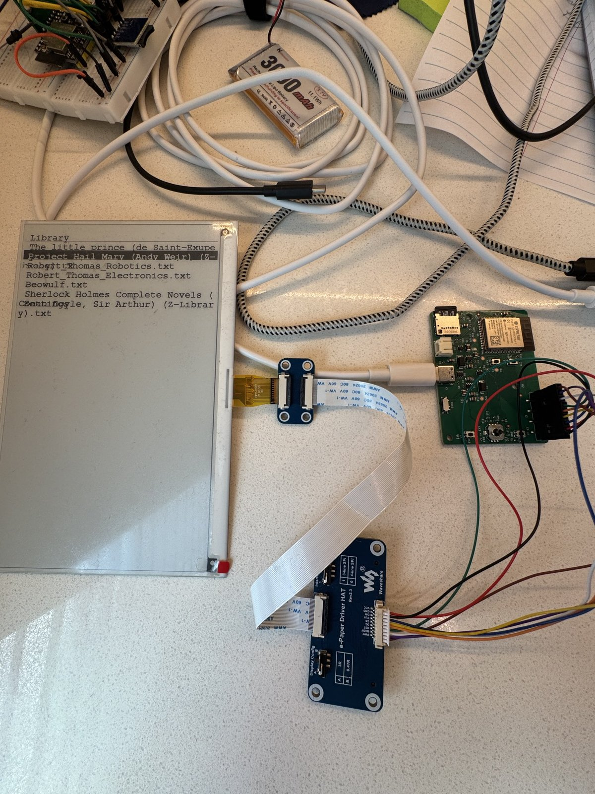
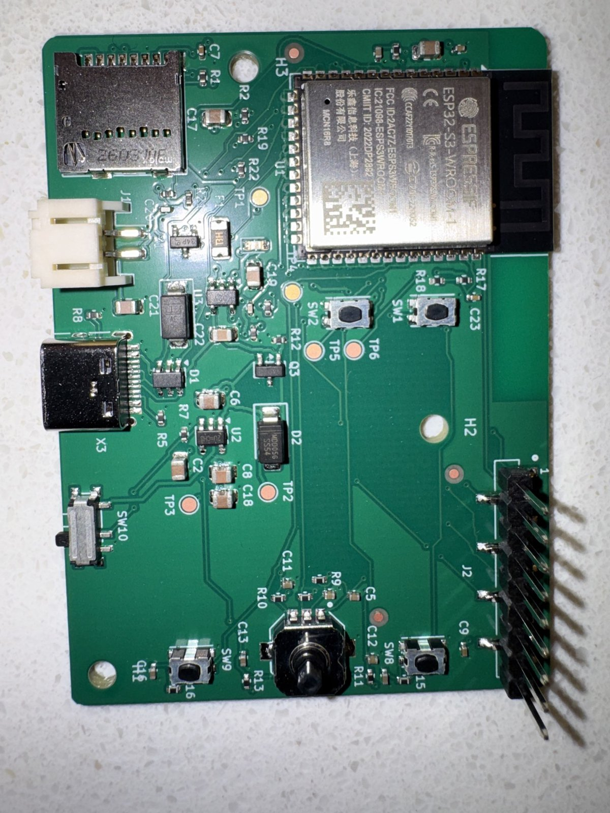
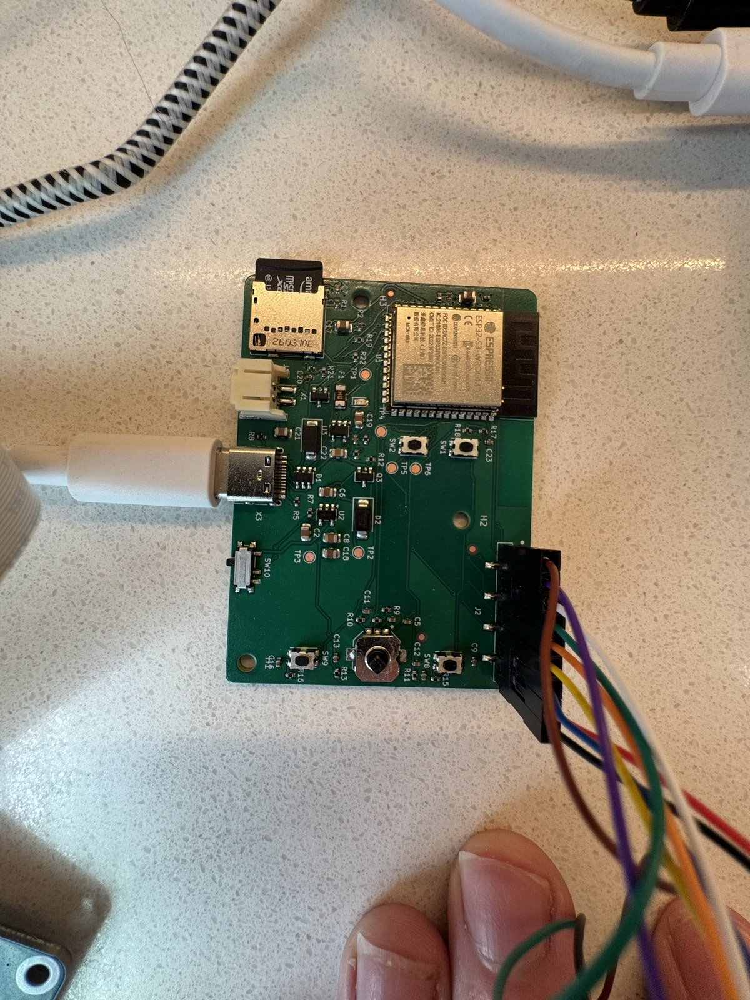
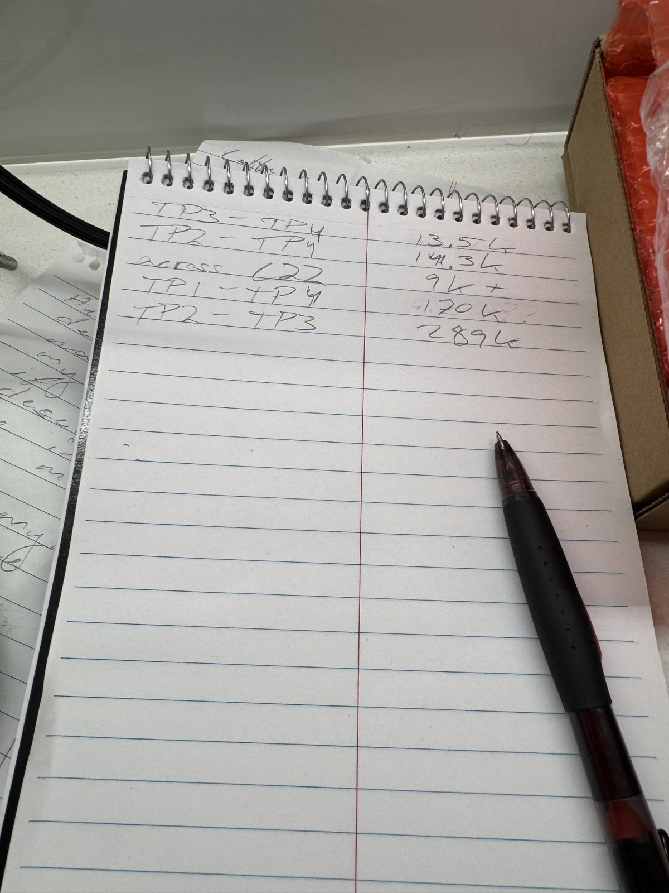
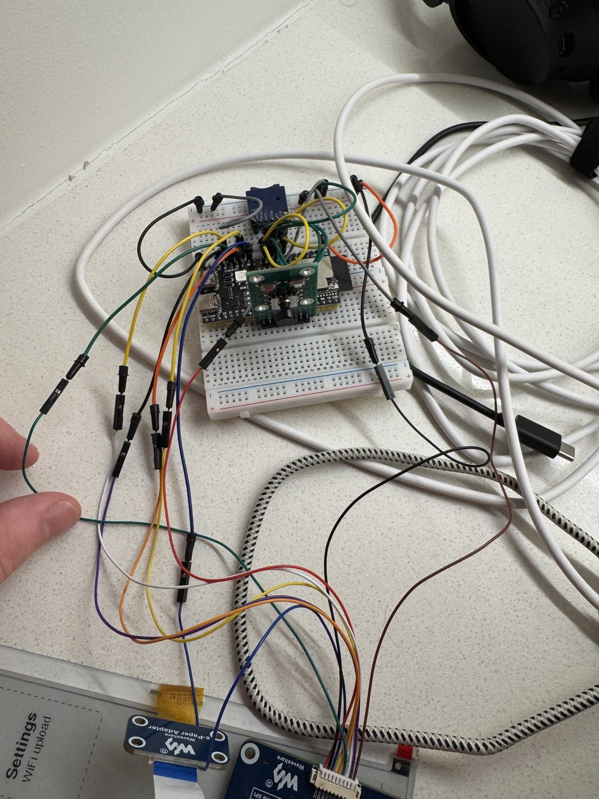

# e-reader

An open-source e-reader built on the ESP32-S3. Bare-metal C++ firmware, web-based book management, physical controls. Designed for FOSS developers to build on top of solid hardware.

<p align="center">
  
  
</p>

## Design files

View the schematic and the 4-layer layout in your browser, no KiCad needed:

[](https://kicanvas.org/?github=https://github.com/robertengineerr/ereader/blob/main/hardware/e_reader_v0.1/e_reader_v0.1.kicad_sch)

[](https://kicanvas.org/?github=https://github.com/robertengineerr/ereader/blob/main/hardware/e_reader_v0.1/e_reader_v0.1.kicad_pcb)

The full KiCad project is in [`hardware/e_reader_v0.1/`](hardware/e_reader_v0.1/). Pin reference is in [`hardware/connections.md`](hardware/connections.md).

## Status

**PCB rev 0.2.0 is built and working.** Boards were fabricated and fully assembled by JLCPCB, then brought up by hand:

| Stage | Result |
|---|---|
| Power-off resistance checks | No shorts (3V3–GND 13.5 kΩ, VHI–GND 141 kΩ) |
| Power rails on USB | VHI 4.9 V; 3V3 3.30 V with the power switch on, 0 V off |
| ESP32-S3 | Flashed over native USB-C; 8 MB PSRAM detected; firmware boots |
| microSD | 128 GB card mounted; books open and paginate |
| Joystick + buttons | Navigation, page turns, SET-at-boot WiFi mode |
| E-paper display | Full refresh 3.7 s, partial page turn 1.6 s |
| WiFi | Connects; books uploaded through `ereader.local` |
| Battery | Not tested yet |

The one bring-up fault was wiring, not the board: the HAT's connector ends `…DIN, GND, VCC` while J2 ends
`…DIN, VCC, GND`, so a straight copy powered the display backwards and pulled 3V3 down to 1.4 V.
The correct J2 wiring is in [`hardware/connections.md`](hardware/connections.md).

<p align="center">
  
  
  
</p>
<p align="center"><em>Board on USB with the display wired · bring-up measurements · the original breadboard prototype</em></p>

## Hardware

| Component | Part (PCB rev 0.2.0) |
|---|---|
| MCU | ESP32-S3-WROOM-1-N16R8 (16 MB flash, 8 MB octal PSRAM) |
| Display | Waveshare 7.5" V2 e-ink (800×480) via driver HAT on a 9-pin header |
| Storage | microSD (Molex 104031-0811), SPI, FAT32, card detect |
| Input | Alps SKRHABE010 5-way joystick, plus SET / RST / BOOT / RESET buttons |
| Battery | 1-cell protected LiPo via JST-PH, MCP73831 charger, PTC + reverse-polarity FET |
| Power | USB-C (charging + native USB programming), RT9080 3.3 V LDO (~2 µA Iq), slide switch on LDO enable |

The BOM, with an LCSC number for every assembled part, is in
[`hardware/e_reader_v0.1/e_reader_v0.1_bom.csv`](hardware/e_reader_v0.1/e_reader_v0.1_bom.csv).
The design-review log is in [`hardware/REVIEW.md`](hardware/REVIEW.md).

**How the board was made.** The schematic started as a hand-drawn v0.1 and was corrected to rev 0.2.0 over several
review rounds. The 4-layer layout (68 × 50 mm; In1 GND plane, In2 3V3 plane) was generated with AI-assisted
Python scripts on KiCad's pcbnew API, in [`hardware/tools/`](hardware/tools/): a placement script, a grid
A* router with rip-up and reroute, and a script that corrects JLCPCB's part rotations and offsets in the CPL.
The result is DRC clean with no unconnected nets.

### Wiring

Full pin tables for the breadboard and the PCB are in [`hardware/connections.md`](hardware/connections.md).
The firmware takes its pins from [`src/pins.h`](src/pins.h): the default build uses the breadboard map,
and `pio run -e pcb` uses the PCB map.

The PCB pins that differ from the breadboard are:
| Signal | Breadboard | PCB | Why |
|---|---|---|---|
| Joystick UP / DOWN | GPIO36 / 37 | GPIO4 / 5 | GPIO35–37 are used by the N16R8's octal PSRAM |
| Joystick COM | GPIO35 driven LOW | GND | |
| Display DIN | GPIO46 | GPIO14 | GPIO46 is a boot strapping pin |
| SD card detect | — | GPIO6 | |
| Battery voltage | — | GPIO1 (×2 divider) | |

## Building

1. Install [PlatformIO](https://platformio.org/)
2. Create `src/secrets.h` with your WiFi credentials:
```cpp
#define WIFI_SSID "your-ssid"
#define WIFI_PASS "your-password"
```
3. Build and flash:
```bash
pio run --target upload            # breadboard (DevKitC-1)
pio run -e pcb --target upload     # custom PCB (first time: SW10 ON, hold BOOT, tap RESET; see hardware/connections.md)
```

## Usage

| Button | Library | Reading | Settings |
|---|---|---|---|
| UP | Cursor up | Previous page | Cursor up |
| DOWN | Cursor down | Next page | Cursor down |
| RIGHT | — | Next page | — |
| MID | Select | Back to library | Select |
| LEFT | — | Back to library | Back to library |
| Hold SET at boot | — | — | Enter WiFi mode |

### WiFi Upload

Hold SET while pressing reset, or navigate **Settings → WiFi Upload**. The device connects to your WiFi and shows `ereader.local` on screen. Open `http://ereader.local` in a browser to upload and delete books.

Supported formats (converted to plain text in the browser):
- `.txt` — uploaded directly
- `.epub` — extracted in browser via JSZip
- `.pdf` — extracted via PDF.js
- `.docx` — extracted via JSZip
- `.html` / `.htm` — stripped in browser
- `.fb2` — parsed in browser

Press MID on the device or click **Exit WiFi Mode** in the browser to return to the library.

### Fallback

If no SD card is present the device falls back to a built-in sample text (Iliad Book I, Pope translation) so the UI is always usable.

## Project Structure

```
src/
  main.cpp          # setup, loop, ISR input handling, state machine
  display.cpp/h     # e-ink display abstraction (GxEPD2)
  sd_manager.cpp/h  # SD card init, book listing, pagination engine
  network.cpp/h     # WiFi, HTTP file manager, mDNS
  web_ui.h          # embedded HTML/JS for the browser file manager
  secrets.h         # WiFi credentials (not in repo — create your own)

hardware/
  connections.md              # full pin reference, first-flash steps, bring-up log
  REVIEW.md                   # design-review rounds and findings
  e_reader_v0.1/              # KiCad project (schematic + PCB), fab/ has Gerbers, BOM, CPL
  tools/                      # Python placement, routing and CPL-correction scripts
  enclosure/                  # CadQuery enclosure (STEP for Onshape, STL for printing)

docs/images/                  # photos of the board and bring-up
```

## Roadmap

- [x] Text rendering on e-ink display
- [x] SD card file management
- [x] State machine UI (Library / Reading / Settings)
- [x] WiFi upload with multi-format support
- [x] mDNS (`ereader.local`)
- [x] Hardware schematic v0.1
- [x] Schematic rev 0.2.0: power fixes, 5-way joystick, BOM with LCSC numbers (3 review rounds)
- [x] PCB layout (4-layer, routed, DRC clean) and JLCPCB fab files in `hardware/e_reader_v0.1/fab/`
- [x] Fabrication and bring-up (everything except the battery verified)
- [x] LiPo battery + charging circuit (MCP73831 + RT9080) in schematic
- [ ] Persist reading position (LittleFS)
- [ ] EPUB native rendering
- [ ] 3D printed enclosure (designed in `hardware/enclosure/`, not printed yet)
- [ ] Battery bring-up and on-screen battery level
- [ ] Rev 0.3 layout by hand

## License

MIT
